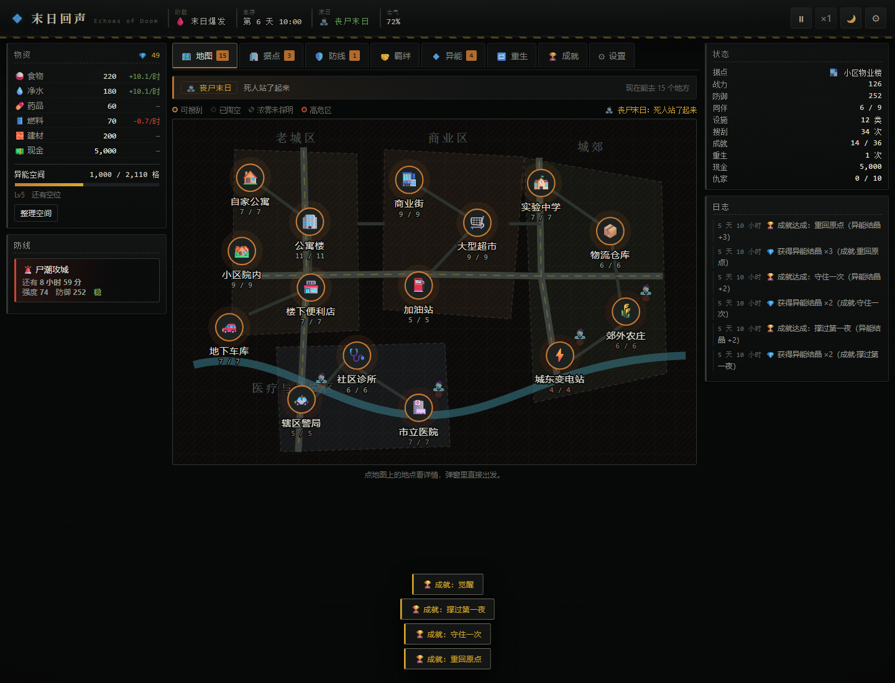
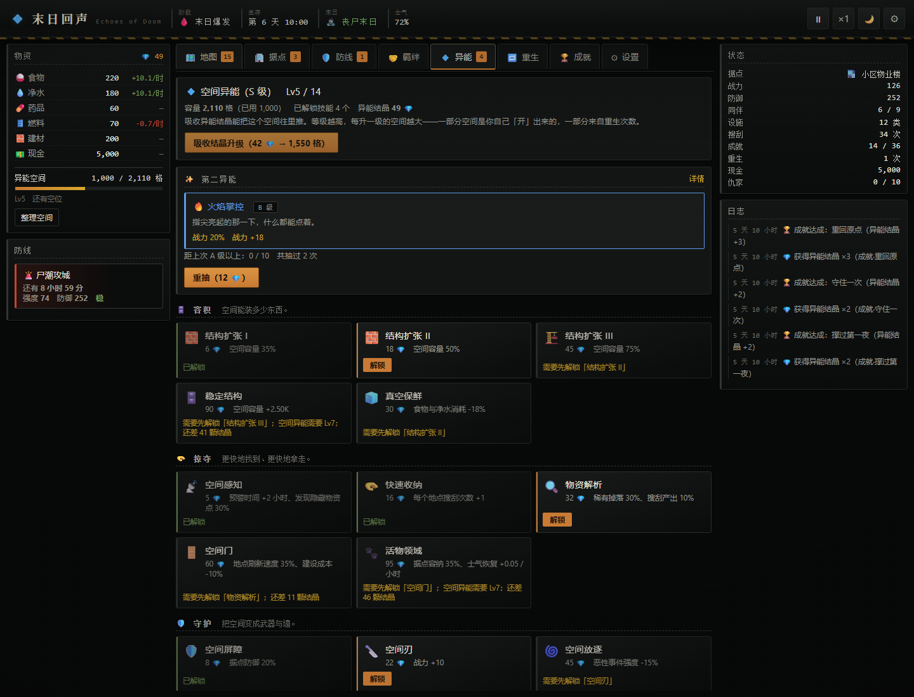
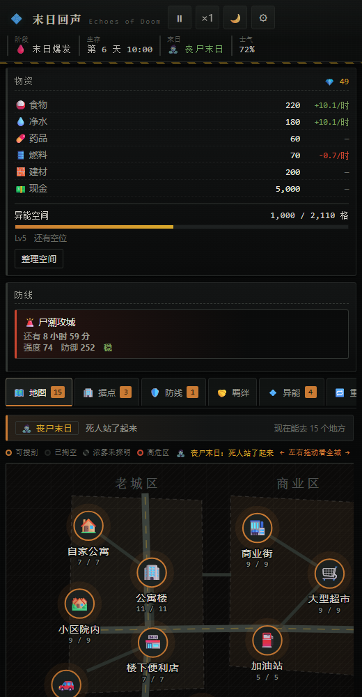

# 末日回声 · Echoes of Doom

一个**末日超能力生存**题材的单机放置游戏（Idle / Incremental）：
上一世被兄弟和女人关在仓库里，再睁眼是末日爆发前三天。你带着 S 级空间异能重生回来，
有七十二小时把这座城市搬进自己的空间。

纯前端实现、零依赖、可离线运行：双击 `index.html` 就能玩，不需要本地服务器。

## 玩法一眼看懂

* **搜刮 → 空间 → 建设 → 抵御**：地图上 15 个地点各有限次与刷新，物资全部装进异能空间；
  空间容量用异能结晶扩容，是全局唯一的仓储上限。
* **地图探索**：「地图」页是一张可点的城区图（四个城区、道路与河道、15 个节点）。
  点节点先在地图上选中，再从地图下方的抽屉里确认「出发」；未探明的地点是雾。
  洪水会淹掉低洼地点并让河道涨水，核冬天标出辐射区，丧尸末日标出尸群出没的高危区。
* **三个阶段**：末日前（72 小时倒计时）→ 末日爆发 → 末日。每个阶段解禁新内容：
  爆发时觉醒第二异能，末日阶段开启重生。
* **羁绊**：17 位角色在搜刮与事件里出现。好感靠剧情选择与送礼堆，够了会开始协助你，
  关键节点的选择决定他们最终是兄弟、伴侣还是敌人。羁绊不跨重生继承。
* **据点**：4 级据点、22 种设施，从加固门窗一路修到围墙、哨塔、农田、温室、雷达站。
* **恶性事件**：尸潮、掠夺队、洪水、兽潮随阶段变强，预警窗口内抢修工事；据点被攻占直接触发重生。
* **遭遇战**：室外搜刮撞上敌人会弹窗，写清对方种类、人数与总战力、双方差距与胜率；
  打不过就只能跑，跑不掉会丢物资（还能选「丢下物资再跑」提高成功率）；
  打输或连逃三次被冲散，那个地点会被占住，想提前拿回来就带人「夺回」。
* **钱只能借或抢**：搜刮搜不出钱。借钱花好感（同一个人越借越贵），抢钱要战力够（抢完手不干净）；
  抢多了会记仇家 —— 有人上门算账，袭击也会变成「仇家清算」。
* **隐藏物资点**：偶尔在废墟里发现藏起来的物资，弹窗会说明地点与来龙去脉，
  可全搬、只挑值钱的，或先记下来（地图留 📦 标记，搬走才消失）。
* **重生**：每次重来随机换一种末日类型（丧尸 / 极寒 / 洪水 / 核冬天），
  只有空间异能、结晶、重生点与成就跟着你走。

## 快速开始

### 桌面快捷方式

```
tools\run.ps1 tools\gen-icon.js             # 生成 assets/icon.ico（桌面图标，纯代码画的）
.\tools\make-desktop-shortcut.ps1           # 在桌面创建 / 刷新「末日回声」快捷方式
```

快捷方式指向单文件版 `dist/echoes-of-doom.html`，双击就用默认浏览器打开，不依赖这个文件夹是否被移动
（也可以直接把那个 HTML 复制到任何地方）。要改名字、图标或入口，改 `tools/shortcut.json` 再跑一次脚本即可。
图标预览在 `assets/icon-preview.png`。

* **本地运行**：双击 `index.html`（或把整个目录拖进浏览器）。全部脚本都是普通 `<script>`，
  `file://` 下可以直接跑。
* **单文件版**（方便分享 / 离线保存）：`node tools/build-single-file.js` →
  `dist/echoes-of-doom.html` 一个文件就能玩。
* 存档在浏览器 `localStorage`，关掉页面再打开会结算离线收益（离线期间不会结算恶性事件）；
  也可以在「设置」里导出 / 导入存档文本。

> 时间尺度：1 现实秒 = 3 游戏分钟，末日前那 72 小时约等于现实 24 分钟。
> 顶栏的 ×1 按钮可以切到 ×2 / ×3 / ×4。

## 时间与阶段

| 阶段 | 游戏时间 | 开放的东西 |
| --- | --- | --- |
| 末日前 | 0 ~ 72 小时 | 搜刮、异能升级与技能树、据点设施、羁绊相遇、随机事件 |
| 末日爆发 | 72 ~ 168 小时 | 觉醒第二异能（首次免费）、恶性事件开始、解决上一世的账 |
| 末日 | 168 小时之后 | 据点迁移、重生与重生商店、更凶的恶性事件 |

> 末日前那三天是**回合制**：搜刮一次 1 小时（危险区 1.5 小时）、施工 2 小时、送礼 0.5 小时，
> 倒计时跟着你的操作走（顶栏写着「约 N 次出门」）。末日爆发之后时间才开始自己走，流速设置也只从那时生效。

## 界面

「地图」页：一张城区地图，节点上直接标着剩余次数、危险度与刷新倒计时，点节点在下方抽屉里确认出发。



「异能」页：空间等级 / 容量、第二异能、四条技能树分支（容积 / 掠夺 / 守护 / 虚空）。



窄屏：单列布局，地图保持可读宽度、左右拖动看全城。



## 工程结构

> **版本号**：上线前冻结在 `0.1.0`（GitHub 仓库建立、正式上线之前一直不变）。
> 改动都写进 `CHANGELOG.md` 的 `## [未发布]`，上线时并进 0.1.0；上线之后才按规则递增
> （玩法结构大改 → 主版本；新增系统或内容 → 次版本；平衡/界面/文案/修复/工具 → 修订号）。

```
index.html            入口（按顺序引入 config → engine → ui）
css/style.css         样式（深色「废土夜色」/ 浅色「灰白晨雾」）
js/config/            纯数据：资源、阶段、末日类型、地点、异能、设施、战斗、羁绊、事件、成就、重生、剧情
js/engine/            纯逻辑：state / effects / production / ability / scavenge / eventengine /
                      bondengine / build / defense / achievements / story / rebirth / actions / save / loop
js/ui/                渲染：dom / tips / panels / modals / tab-* / app / acts
tools/                构建与自检脚本（见下）
```

## 自检与发布

沙箱环境里 `node script.js` 会因为 realpath 受限报 `EPERM: lstat`，所以统一走 `tools/run.ps1`
（内部用 `node -e` + `vm.runInThisContext`）：

```
tools\run.ps1 tools\check-env.js            # 环境自检：换电脑之后先跑这个
tools\run.ps1 tools\scan-effect-keys.js     # 效果键全量扫描：引擎认不认识配置里的每个键
tools\run.ps1 tools\audit.js                # 配置体检：id 引用、解锁链死循环、数值极值表
tools\check.ps1                             # 无头 Chrome 端到端自检（宽屏 + 窄屏各跑一轮 150+ 断言）
tools\check-reset.ps1                       # 「清除存档」的真实重载路径自检（会真的 location.reload 一次）
tools\smoke.ps1                             # 多文件版冒烟：直接打开 index.html 能不能正常渲染
tools\shots.ps1                             # 截界面图到 screenshots/
tools\run.ps1 tools\build-single-file.js    # 重新构建单文件版
tools\run.ps1 tools\gen-changelog.js        # 由 CHANGELOG.md 生成游戏内更新日志
```

`tools\check.ps1` 的结果会写到 `work/dev-driver-report-*.txt`（临时页面用完即删）。
`work\` 只是草稿目录，删掉不影响游戏。

固定的发布流水线（顺序不能乱）：

```
改代码 → 写 CHANGELOG → 生成游戏内日志 → 重建单文件版 → 跑自检 → 提交（中文，写清根因）
```

## 加立绘和背景图

图片按 **id 命名**放进 `assets/`，跑两个脚本就生效，不用改任何代码：

| 目录 | 放什么 | 文件名 | 建议尺寸 |
| --- | --- | --- | --- |
| `assets/portraits/` | 17 位羁绊角色的立绘 | `<羁绊id>.png` | 768×1024（3:4），透明底或深色底 |
| `assets/scenes/` | 15 个搜刮地点的背景 | `<地点id>.jpg` | 1280×720（16:9） |
| `assets/dooms/` | 4 种末日的氛围图 | `<末日id>.jpg` | 1280×720 |

```
tools\run.ps1 tools\gen-asset-manifest.js   # 扫描 assets/，生成图片清单
tools\run.ps1 tools\build-single-file.js    # 单文件版把图内联成 data URI（会报总体积）
```

### 用 AI 批量出图（Gemini / OpenAI）

`tools/art-spec.js` 里已经写好 36 条提示词（17 立绘 + 15 地点 + 4 末日），画风段固定、每条只换主体。
想先看清单：`tools\run.ps1 tools\gen-art.js --dump` → 生成 `tools/art-prompts.md`。

```
# 先不花钱验一遍管线：用占位图跑通「落盘 → 清单 → 单文件内联 → 界面显示」
tools\run.ps1 tools\gen-art.js --dry-run

# 真出图（先把 key 设成环境变量，别写进命令行）
tools\run.ps1 tools\gen-art.js --provider gemini
tools\run.ps1 tools\gen-art.js --provider gemini --only wangyi,market,hospital   # 只做几张
tools\run.ps1 tools\gen-art.js --kind scenes                                    # 只做一类
tools\run.ps1 tools\gen-art.js --provider gemini --model imagen-4.0-generate-001
```

* Key 有两个来源，都不需要写进命令行：环境变量 `GEMINI_API_KEY`，或本地文件 `work/gemini.key`（一行，`work/` 不参与打包）。
  `GEMINI_API_BASE` 可以换成代理地址。
* 已经出好的图默认跳过，中断后重跑即可续上；要重画加 `--force`。
* 模型默认 `gemini-2.5-flash-image`；名字以 `imagen` 开头时会自动改用 Imagen 的 `:predict` 接口。
* 出完记得跑 `gen-asset-manifest.js` + `build-single-file.js`（脚本末尾会提醒）。

id 对照表在 [assets/README.md](assets/README.md)。支持 `.webp` / `.png` / `.jpg`，
同 id 多个格式按 webp > png > jpg 取。**没有图片也照常玩**：界面上画的是「档案未归档」占位框，
位置与尺寸和最终效果一致，不会白等。

### 出图提示词（已经写进工程，不用手写）

36 条提示词都在 `tools/art-spec.js` 里，画风段固定、每条只换主体。要看完整清单：

```
tools\run.ps1 tools\gen-art.js --dump     # → tools/art-prompts.md
```

画风是反复对齐过的，**别改回去**：目标是「半写实游戏 CG 立绘」—— 清晰锐利、有画意，
五官精致好看、眼神有光、打光有立绘感；既不要厚涂油画，也不要纪实摄影 / 新闻照 /
手机随手拍那种平光素人感。画风基准图是 `assets/portraits/baimanman.jpg`，
出图时把它当参考图一起传，风格最稳。

## 换一台电脑 / 换个人接手

工程不依赖任何本机路径（浏览器路径自动探测，装了 Chrome 或 Edge 就行），拷走就能在别处继续做。
**不要把 `work\` 拷过去**（临时页面、自检报告、出图源图都在里面），
**API Key 也不在工程里**，要在新机器上重新设。

```
.\tools\pack-for-transfer.ps1     # 打一个干净的 zip：自动排除 work\、.git\、gemini.key
```

跑完 zip 会放在工程目录**外面**（`outputs\echoes-of-doom-src-<日期>.zip`，约 5 MB），
并会检查里面有没有混进 `work\` 或 key 文件。

到了新机器：解压到任意位置 → 装 **Node.js LTS**（18+）与 **Chrome** →
设好出图 Key（环境变量 `GEMINI_API_KEY`，或写进 `work\gemini.key`）→
用 Codex 打开这个文件夹，**让它先读 `AGENTS.md`**（沙箱坑、分层、版本号规则、自检清单都在里面）→
跑下面两条，看到 `ALL GREEN` 就说明环境没问题：

```
tools\run.ps1 tools\check-env.js     # 环境自检：node / PowerShell / 浏览器 / 写权限 / 产物
tools\check.ps1                      # 端到端自检：宽屏 + 窄屏各跑一轮
```

> 桌面快捷方式不是文件，换电脑之后要重跑一次 `tools\make-desktop-shortcut.ps1`。
